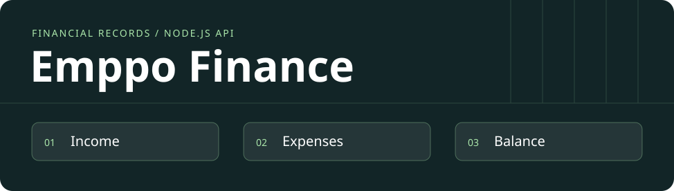

# Emppo Finance

[Português](README.md) · **English**

[](https://github.com/acamilateixeira/emppo-finance/actions/workflows/ci.yml)

**Record income and expenses and see how each entry changes the balance.**

Emppo began as a management dashboard prototype. This public edition presents its first working slice: a Node.js finance API that validates input, persists entries, and calculates the balance in cents. The total can be checked against the stored entries.

**Status:** working local API. The dashboard and its API integration are separate product milestones.

## Architecture

| Choice | Rationale |
| --- | --- |
| **Node.js, TypeScript, and Fastify** | Validate entries at the API boundary and keep finance logic separate from the screens. |
| **Local SQLite** | Entries survive restarts without an external database for the local workflow. |
| **Amounts in cents** | Income and expenses use integer amounts. The balance comes from the stored entries. |
| **API tests** | Tests create entries, reopen the database, check the balance, and verify that invalid data is rejected. |

## Run the local API

Use Node.js 22.18 or newer. The API listens on `127.0.0.1:3001` and writes to `server/emppo.sqlite` when started below. Use synthetic data for this local workflow.

```bash
cd server
npm ci
npm run typecheck
npm test
npm start
```

From another terminal:

```bash
curl -sS http://127.0.0.1:3001/api/entries \
  -H 'Content-Type: application/json' \
  -d '{"name":"Example sale","amountCents":30000,"direction":"income","occurredOn":"2026-03-01"}'
curl -sS http://127.0.0.1:3001/api/summary
```

| Route | Behavior |
| --- | --- |
| `GET /health` | Process health |
| `POST /api/entries` | Records income or an expense |
| `GET /api/entries?direction=expense` | Lists up to 100 entries, with an optional filter |
| `GET /api/summary` | Returns income, expenses, and balance in cents |

The next step is to connect the UI to the API and implement authentication and authorization before a hosted demo.

## Postman, Insomnia, and verification

Import the [Insomnia](insomnia/emppo-finance.json) or [Postman](docs/postman.collection.json) collection. Run the sequence against a local test database. It records income and expenses, filters entries, and rejects an invalid amount. In the Postman collection, automated checks confirm the balance increases by 18,000 cents; in Insomnia, compare the two summaries.
