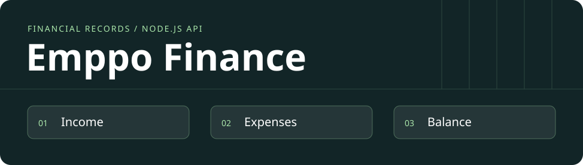

# Emppo Finance

**Português** · [English](README.en.md)

[](https://github.com/acamilateixeira/emppo-finance/actions/workflows/ci.yml)

**Registre receitas e despesas e confira como cada lançamento muda o saldo.**

O Emppo começou como protótipo de painel de gestão. A versão pública apresenta o primeiro fluxo funcional do produto: uma API financeira em Node.js que valida dados, persiste os lançamentos e calcula o saldo em centavos. O saldo pode ser conferido a partir das entradas e saídas registradas.

**Estado:** API funcional para execução local. A interface do protótipo e a integração com a API são etapas separadas do produto.

## Arquitetura

| Escolha | Motivo |
| --- | --- |
| **Node.js, TypeScript e Fastify** | A API valida o formato dos lançamentos na entrada e mantém a lógica financeira separada das telas. |
| **SQLite local** | Os registros sobrevivem a reinícios sem exigir um banco externo para experimentar o fluxo. |
| **Valores em centavos** | Receitas e despesas usam inteiros. O saldo é calculado a partir dos lançamentos persistidos. |
| **Testes de API** | Os testes criam registros, reabrem o banco, conferem o saldo e verificam a rejeição de dados inválidos. |

## Experimentar a API local

Use Node.js 22.18 ou superior. A API escuta em `127.0.0.1:3001` e grava em `server/emppo.sqlite` quando iniciada pelos comandos abaixo. Use dados fictícios neste fluxo local.

```bash
cd server
npm ci
npm run typecheck
npm test
npm start
```

Em outro terminal:

```bash
curl -sS http://127.0.0.1:3001/api/entries \
  -H 'Content-Type: application/json' \
  -d '{"name":"Venda de teste","amountCents":30000,"direction":"income","occurredOn":"2026-03-01"}'
curl -sS http://127.0.0.1:3001/api/summary
```

| Rota | Comportamento |
| --- | --- |
| `GET /health` | Resposta de saúde do processo |
| `POST /api/entries` | Registra receita ou despesa |
| `GET /api/entries?direction=expense` | Lista até 100 lançamentos, com filtro opcional |
| `GET /api/summary` | Devolve receitas, despesas e saldo em centavos |

O próximo passo é ligar as telas à API e implementar autenticação e autorização antes de uma demonstração hospedada.

## Postman, Insomnia e verificação

Importe a [coleção Emppo Finance](docs/postman.collection.json). Rode a sequência em um banco local de teste. Ela registra uma receita e uma despesa, filtra lançamentos, rejeita um valor inválido e confirma que o saldo aumenta em 18.000 centavos.
